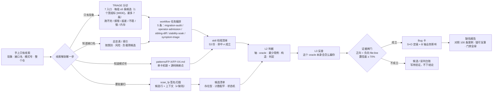

# 昇腾算子故障模式库（v6.63）

[](LICENSE)

> **这是什么**：昇腾（Ascend）NPU 算子缺陷的模式化知识库。把在算子源码检视、跨版本核验与测试集失败分析中反复出现的故障机理，沉淀为「一模式一卡片」的可检索条目，供算子开发与测试人员在做源码审查、缺陷定位、用例设计时直接对照使用。
> **规模**：53 条 / 7 类（精度 22 · 功能兼容 15 · 性能 6 · 资源内存 2 · 测试有效性 2 · 工程交付 4 · 执行可靠性 2）；**条目数**：53。

<!-- BEGIN ENTRY-DIAGRAM（由 scripts/gen_readme_diagram.py 生成，勿手改；新鲜度由 ci_gate.py 校验；脚本在位由 C45 守）） -->

## 一张图看懂



**选路表**（按你手上已有的信息选一条，不必全走）：

| 你手上有什么 | 去哪 | 得到什么 |
|---|---|---|
| 只有现象（跑不完 / 超差 / 偶发 / OOM） | [TRIAGE.md](TRIAGE.md) | 7 个入口；每组 ≤6 条候选（1 个宽组标 [WIDE]，最多 7 条） |
| 知道接口名或算子名 | 下方[总览表](#总览表快速索引) | 按类别筛出的候选模式 |
| 知道模式编号 | `patterns/FP-X/FP-XX.md` | 单卡机理 + 映射点 |
| 要批量扫代码仓 | `scripts/scan_fp.py` | 带行号的候选（≠缺陷） |
| 要让 agent 自主挖 | [AGENTS.md](AGENTS.md) | 一页速查：读什么 / 跳过什么 |
| 想先逛一遍全库 | [site/index.html](site/index.html) | 单文件站点，双击即开 |

**库里有什么**（数字由 `scripts/gen_readme_diagram.py` 从真源注入，勿手改）：
53 条模式（其中 20 条深度档带完整检视 skill）· 53 份 skill · 5 条工作流 · 100 条实证案例（42 个真实锚）。

<!-- END ENTRY-DIAGRAM -->

> **版本**：v6.63（2026-11-09）——「racecheck 告警的定性纪律」：把「报出来的 hazard 到底是不是缺陷」固化为四分类判据（WAW 跨 block 同址→原子累加/索引重复；WAR 同 block 相邻→屏障未被识别；RAW 单方块内两 pipe→需读源码、闭源记未定；相邻 block→AIV/AIC 协作对）。实测背景：Ascend950PR + CANN 9.2.0-beta.2，27 探针 / 273 kernel / 7000+ 处告警，逐条查源码后**可提交缺陷 0 个**。同时补充两条版本落差易错点：`__NPU_ARCH__` 不等于 SoC 型号、同算子按 arch 分目录时同步逻辑只在某一个 arch 下。**未新增模式、未改定级**（仍 53 条）。逐版明细见 [CHANGELOG.md](CHANGELOG.md) 首行。

> **怎么开始**：只有现象 → [TRIAGE.md](TRIAGE.md)；知道查哪条 → 下方总览表；让 agent 自行挖掘 → [AGENTS.md](AGENTS.md)；想逛一遍全库 → 打开 [site/index.html](site/index.html)（单文件零依赖）；跑门禁 → `python3 check_fault_patterns.py`。
> **机器可读索引**：`fault_patterns_index.json`（含 `detect` 判据层）。

---

## 文档地图

本仓把「入口」「规则」「用法」分开存放，各自读者与更新频率不同。找东西先看这张表。

| 我想…… | 读这一份 | 体量 |
|---|---|---|
| 30 秒内决定从哪下手 | [AGENTS.md](AGENTS.md)（agent 速查）/ 上方选路表 | 一页 |
| 只有现象、不知查哪条 | [TRIAGE.md](TRIAGE.md)（7 入口，每组 ≤6 条候选，宽组标 [WIDE] 例外） | 分诊表 |
| 按类别 / 风险 / 负载筛候选 | 下方[总览表](#总览表快速索引)（53 行） | 9 KB |
| 知道模式号，看机理与映射点 | `patterns/FP-X/FP-XX.md`（单卡 2~7 KB） | 53 份 |
| 照检视清单逐项核查 | `skills/FP-X/<skill>/SKILL.md`（53/53 已建） | 53 份 |
| 查收录 / 定级 / 维护规则（12 条库标准） | [docs/STANDARDS.md](docs/STANDARDS.md) | 14 KB |
| 查扫描器 / 评测 / 工作流的完整用法 | [docs/USAGE.md](docs/USAGE.md) | 18 KB |
| 判断结论成色（found/clean/uncovered） | [EVIDENCE_DISCIPLINE.md](EVIDENCE_DISCIPLINE.md)（14 条证据纪律） | 11.6 KB |
| 找候选定性的底座（对象/单位/生命周期/消费者） | [INVARIANTS.md](INVARIANTS.md)（四条不变量） | 9.0 KB |
| 看历史缺陷案例与真实修复锚 | [cases/cases.json](cases/cases.json)（100 条案例 / 42 个锚） | 机读 |
| 逛一遍全库 | [site/index.html](site/index.html) | 单文件 |

---

## 三层取用：先分辨你要哪一层

取错层是用例设计最常见的失效原因。

| 层 | 回答什么 | 关键字段 | 谁在用 |
|---|---|---|---|
| **L1 机理层** | 为什么会坏 | `applicability` / `mechanism` / `trigger` / `symptom` / `signatures` | 代码审查、静态扫描 |
| **L2 判据层** | 怎么测才能测出来 | `detect.axes` / `oracle` / `signal` / `lines` / `min_cases` / `constructor` / `judge` / `kill` | 用例设计、bug 挖掘 |
| **L3 失效模式** | 这个观测手段**本身**会怎么骗你 | `detect_layer.oracle_failures.by_oracle`（按 oracle 类别，69 条实测） | 判读阶段：FAIL 是真缺陷还是判据假阳 |

**只读 L1** 得到的是一条「可能存在入库校验参差」的结论，无法上板；**读 L2** 才有轴、观测手段、构造方法、判定口径与判别力；但 `oracle` 存在 ≠ `oracle` 可信——同一个 `golden-utol`，在 `inf==inf`、缺 `equal_nan`、容差按 `out` dtype 取这三种情形下都会给出与事实相反的结论（实测「396/396 全假 FAIL」）。**判读任何 FAIL 之前，先查对应 oracle 类别的 L3 条目。** 详见 [docs/USAGE.md §一](docs/USAGE.md)。

---

## 规模与覆盖（数字口径）

本节数字由真源口径给出，**由守门 C50 逐项核**（改了库忘改这里会直接报错）。

| 维度 | 数值 | 真源 |
|---|---|---|
| 模式卡 | **53 张卡**（7 类） | `patterns/` |
| 可扫签名 | 签名扫描覆盖 50/53；其余 3 条为 `必须触发` 或 `无代码触发特征` | `fault_patterns_index.json` |
| 子型机读化 | **22 个模式已机读化 102 条子型**（4 条带存在型指纹 / 2 条带配对结构判据，其余靠 skill 清单人工核） | 同上 `subtypes` |
| 第二判据 | 29/53 条模式只有单一判据；已为 24 模式 / 45 条关系补第二 oracle（高优先级 20/20 全覆盖） | `fault_patterns_secondary_oracle.json` |
| 检视技能 | 每模式一份（`skills/FP-X/<skill>/SKILL.md`） | `skills/` |
| 评测集 | 53 份 × 3 类用例，共 53×3 用例 | `evals/` |
| 实证案例 | 百分条级案例库 / 42 个真实修复锚 | `cases/cases.json` |
| 工作流 | 5 条（准入 / 现象定位 / 迁移 / 稳定性 / 兄弟对拍） | `workflows/` |

---

## 目录结构

```text
ascend-op-fault-patterns/
├── README.md                     # 本文件：入口 + 选路 + 三层对照 + 总览索引
├── AGENTS.md                     # agent 一页速查：读什么 / 跳过什么 / 怎么产出（尾部计数由 C47 守）
├── TRIAGE.md                     # 症状分诊表：7 入口（gen_triage.py 生成，勿手改）
├── CHANGELOG.md                  # 变更记录（本库唯一变更登记处，日期倒序）
├── INVARIANTS.md                 # 四条全局不变量：判定底座（v6.22）
├── EVIDENCE_DISCIPLINE.md        # 十四条证据纪律：判 found/clean/uncovered 的成色（v6.28）
├── REFACTOR_REPORT.md            # 拆分重构说明（动机 / 业界参照 / 兼容性 / 校验结果）
├── LICENSE                       # CANN Open Software License Agreement 2.0
├── docs/
│   ├── STANDARDS.md              # 库标准 12 条 + 维护约定 + 业界参照
│   └── USAGE.md                  # 消费方式全量说明（三层取用 / 工作流 / 命令行工具）
├── patterns/                     # 53 个单模式卡片（FP-A01.md ~ FP-G02.md，按类别分 7 目录）
├── skills/                       # 模式技能层：一模式一目录一 SKILL.md（53/53）；编写规范见其 README
├── cases/                        # 案例库：cases.json（100 条）/ misjudgments.jsonl（误判台账）
│                                 #         / sig_yield-ops-math.*（产出审计基线，生成物勿手改）
├── evals/                        # 评测集：每模式 3 类用例 + 协议 README
├── workflows/                    # 任务级编排 5 条：准入 / 现象定位 / 迁移 / 稳定性 / 兄弟对拍
├── site/index.html               # 可视化站点（单文件零依赖，gen_site.py 生成，勿手改）
├── fault_patterns_index.json     # 机器可读索引（全字段 + file + detect 判据层）
├── fault_patterns_detect.json    # L2 判据层真源（axes/oracle/judge/kill）
├── fault_patterns_secondary_oracle.json  # 第二判据真源（metamorphic / cross-path / invariant）
├── pattern_compositions.json     # 组合故障 + 可直接执行的 next_experiment
├── triage_map.json               # 分诊映射（人工维护，TRIAGE.md 的生成输入）
├── .gitlab-ci.yml                # CI：blocking 门禁必须全绿才能合
├── check_fault_patterns.py       # 结构一致性守门（C1~C50）
└── scripts/                      # 25 个工具：生成（gen_* / sync_*）、扫描（scan_*）、
                                  #   校验（check_* / ci_gate / run_eval / verify_lines）、
                                  #   查询（query_patterns）、变异（mutate_ops）
```

各子目录的 schema 与字段口径见其自身 `README.md`。

---

## 总览表（快速索引）

> **「触发」列怎么读（v6.2，5 值）**：`必须触发` = 不依赖签名、无条件走清单；`签名` = 有 ≥1 条可扫指纹，`scan_fp.py` 能直接出候选；`宽泛定位` = 只有宽泛签名（存在即常态，扫描器标 `[BROAD]`，仅定位用）；`关键词` = 只有 `keywords` 提示、不产候选；`无代码触发特征` = 无代码面可扫。当前 **50/53 有可扫签名**，3 条无签名（FP-A22 / FP-C04 / FP-E02，其中 A22 为「必须触发」故不依赖签名）。`负载` 列即核查深度（深度 / 标准 / 宽浅），抽样规则见 [skills/README.md](skills/README.md) 第 10 条。

| 编号 | 名称 | 类别 | 风险 | 状态 | 负载 | 触发 | 实证 |
|------|------|------|------|------|------|------|------|
| [FP-A01](patterns/FP-A/FP-A01.md) | 硬件指令精度不足，未与竞品对齐 | 精度 | 高 | 活跃 | 深度 | 签名 | 3 issue（2 仓） |
| [FP-A02](patterns/FP-A/FP-A02.md) | 归约/累加实现顺序与竞品不一致 | 精度 | 高 | 活跃 | 深度 | 签名 | 2 issue |
| [FP-A03](patterns/FP-A/FP-A03.md) | 竞品高精度中间计算，NPU 直接低精度 | 精度 | 高 | 活跃 | 标准 | 宽泛定位 | 2 issue |
| [FP-A04](patterns/FP-A/FP-A04.md) | 功能问题演变为精度静默故障 | 精度 | 高 | 活跃 | 标准 | 宽泛定位 | 多 issue（2 仓） |
| [FP-A05](patterns/FP-A/FP-A05.md) | 脏数据 / 数据踩踏 | 精度 | 高 | 活跃 | 标准 | 签名 | 1 issue |
| [FP-A06](patterns/FP-A/FP-A06.md) | 确定性开关下结果不固定 | 精度 | 高 | 活跃 | 标准 | 签名 | 多 issue（3 仓） |
| [FP-A07](patterns/FP-A/FP-A07.md) | tiling 条件判断错误走入错误分支 | 精度 | 高 | 活跃 | 标准 | 签名 | 2 issue |
| [FP-A08](patterns/FP-A/FP-A08.md) | 切块粒度差异致离群点精度问题 | 精度 | 高 | 活跃 | 深度 | 签名 | 多 issue（2 仓） |
| [FP-A09](patterns/FP-A/FP-A09.md) | 对标 TF 语义与 PTA（torch_npu）不一致 | 精度 | 中 | 活跃 | 宽浅 | 宽泛定位 | 未证实（检索无对应） |
| [FP-A10](patterns/FP-A/FP-A10.md) | 原型 Attr 不支持 Double | 精度 | 高 | 活跃 | 标准 | 签名 | 2 issue（2 仓） |
| [FP-A11](patterns/FP-A/FP-A11.md) | AiCore 不支持 double 类型 | 精度 | 高 | 活跃 | 标准 | 签名 | 4 issue（2 仓） |
| [FP-A12](patterns/FP-A/FP-A12.md) | 大整数转 fp32 计算精度损失 | 精度 | 中 | 活跃 | 标准 | 签名 | 笔记+扫描 |
| [FP-A13](patterns/FP-A/FP-A13.md) | 输入尾数截断才能通过精度标准 | 精度 | 中 | 活跃 | 宽浅 | 宽泛定位 | 未证实（检索无对应） |
| [FP-A14](patterns/FP-A/FP-A14.md) | FFMA 与 MMAD 硬件指令差异 | 精度 | 高 | 活跃 | 深度 | 签名 | 3 issue（2 仓） |
| [FP-A15](patterns/FP-A/FP-A15.md) | inf/nan 特殊值行为差异 | 精度 | 高 | 活跃 | 标准 | 签名 | 1 issue |
| [FP-A16](patterns/FP-A/FP-A16.md) | aclop 与 aclnn 编译阶段精度差异 | 精度 | 高 | 活跃 | 标准 | 签名 | 2 issue（1 仓） |
| [FP-A17](patterns/FP-A/FP-A17.md) | A1 与 A2 硬件代际精度差异 | 精度 | 中 | 活跃 | 宽浅 | 签名 | 未证实（检索无对应） |
| [FP-A18](patterns/FP-A/FP-A18.md) | int32 边界值转 float 舍入致比较语义偏差 | 精度 | 高 | 活跃 | 标准 | 签名 | 1 issue+58 处扫描 |
| [FP-A19](patterns/FP-A/FP-A19.md) | 同算子多 tiling 路径覆盖盲区 | 精度 | 高 | 活跃 | 深度 | 签名 | 1 实证（rms_norm_grad 跨分支核验） |
| [FP-A20](patterns/FP-A/FP-A20.md) | 确定性等级未分级标注 | 精度 | 高 | 活跃 | 深度 | 签名 | 2 实证（#4890 + rms_norm_grad 跨分支核验） |
| [FP-A21](patterns/FP-A/FP-A21.md) | tiling 可重入性缺失致跨调用/跨线程污染（TU 级可变全局） | 精度 | 高 | 活跃 | 深度 | 签名 | 2 实证（#3758 + 四仓扫描成簇） |
| [FP-A22](patterns/FP-A/FP-A22.md) | kernel dtype 分派/模板映射错配（特定 dtype 静默走错分支） | 精度 | 高 | 活跃 | 深度 | 必须触发 | 2 issue（ops-math #3747/#3748） |
| [FP-B01](patterns/FP-B/FP-B01.md) | 支持面校验过严误拦截合法输入 | 功能/兼容 | 中 | 活跃 | 标准 | 签名 | 1 issue |
| [FP-B02](patterns/FP-B/FP-B02.md) | tiling 未适配多种芯片核数 | 功能/兼容 | 高 | 活跃 | 标准 | 签名 | 8 issue（3 仓） |
| [FP-B03](patterns/FP-B/FP-B03.md) | 跨仓迁移丢失防御/拦截逻辑 | 功能/兼容 | 高 | 活跃 | 标准 | 签名 | 1 issue |
| [FP-B04](patterns/FP-B/FP-B04.md) | aclnn 必选入参空指针校验缺失 | 功能/兼容 | 高 | 活跃 | 深度 | 必须触发 | 多 issue（四仓） |
| [FP-B05](patterns/FP-B/FP-B05.md) | 入参校验覆盖度参差（同仓内文件级） | 功能/兼容 | 低 | 活跃 | 宽浅 | 签名 | 静态扫描 |
| [FP-B06](patterns/FP-B/FP-B06.md) | 空 tensor（numel==0）输入分支处理缺失 | 功能/兼容 | 高 | 活跃 | 深度 | 必须触发 | 1 issue+四仓扫描(1040 接口) |
| [FP-B07](patterns/FP-B/FP-B07.md) | 索引/偏移计算错误致越界 | 功能/兼容 | 高 | 活跃 | 深度 | 必须触发 | 5 issue+四仓扫描(125 条) |
| [FP-B08](patterns/FP-B/FP-B08.md) | 节点级配置未参与派发决策（属性在某一跳被丢弃：fallback 回调 / 前端插件 / fusion pass） | 功能/兼容 | 高 | 活跃 | 深度 | 签名 | 3 issue（3 载体）+ 1 关联 |
| [FP-B09](patterns/FP-B/FP-B09.md) | 动态 shape 标签未参与校验决策（`-2`/`-1` 被当真实维度） | 功能/兼容 | 高 | 活跃 | 深度 | 签名 | 6 issue（1 仓） |
| [FP-B10](patterns/FP-B/FP-B10.md) | 集合通信算子功能/兼容问题（通信域/拓扑/图模式契约/同族不对称） | 功能/兼容 | 高 | 活跃 | 深度 | 签名 | 7 issue（hccl 714 条语料） |
| [FP-B11](patterns/FP-B/FP-B11.md) | 第一段接口/InferShape 参数契约校验缺失（非法 shape/rank/attr 放行） | 功能/兼容 | 高 | 活跃 | 深度 | 签名 | ops-cv 语料 52 条 |
| [FP-B12](patterns/FP-B/FP-B12.md) | 空/退化输入早退路径未写非空输出（SUCCESS + 未初始化输出） | 功能/兼容 | 高 | 活跃 | 深度 | 签名 | ops-cv 语料 5 条 |
| [FP-B13](patterns/FP-B/FP-B13.md) | host 侧 int64→int32 窄化/乘积溢出（参数值静默改变） | 功能/兼容 | 高 | 活跃 | 标准 | 签名 | ops-cv 语料 5 条 |
| [FP-B14](patterns/FP-B/FP-B14.md) | 图模式（GEIR/aclGraph）通路与 aclnn 单算子通路未同步适配 | 功能/兼容 | 高 | 活跃 | 深度 | 签名 | 三仓 69 条 |
| [FP-B15](patterns/FP-B/FP-B15.md) | 定长容器容量无校验（入参索引 + 越界写 + 静默截断） | 功能/兼容 | 高 | 活跃 | 标准 | 签名 | ops-nn#8254 + foreach 族 7 处静态命中 |
| [FP-C01](patterns/FP-C/FP-C01.md) | 算子端到端耗时占比高且单次调用耗时高（含 host 侧循环上界写错致重复调度子型） | 性能 | 高 | 活跃 | 深度 | 签名 | 多 issue（3 仓）+ 2 团队笔记 |
| [FP-C02](patterns/FP-C/FP-C02.md) | A2 上 fp16 Vector 算子性能不如 bf16 | 性能 | 高 | 活跃 | 标准 | 宽泛定位 | 2 issue |
| [FP-C03](patterns/FP-C/FP-C03.md) | bf16 与 fp16 性能差异大 | 性能 | 高 | 活跃 | 标准 | 宽泛定位 | 2 issue（1 仓） |
| [FP-C04](patterns/FP-C/FP-C04.md) | A2 B2 机器性能劣于 A2 B3 | 性能 | 低 | 活跃 | 宽浅 | 无代码触发特征 | 未证实（检索无对应） |
| [FP-C05](patterns/FP-C/FP-C05.md) | 确定性场景性能大幅劣于非确定性 | 性能 | 高 | 活跃 | 标准 | 签名 | 多 issue（3 仓） |
| [FP-C06](patterns/FP-C/FP-C06.md) | A5 性能劣于 A2 | 性能 | 高 | 活跃 | 标准 | 签名 | 多 issue（3 仓） |
| [FP-D01](patterns/FP-D/FP-D01.md) | GPU 迁移 NPU 场景显存过度占用 | 资源/内存 | 高 | 活跃 | 标准 | 签名 | 多 issue（1 仓） |
| [FP-D02](patterns/FP-D/FP-D02.md) | aclnn 内存占用高于 aclop | 资源/内存 | 中 | 活跃 | 宽浅 | 宽泛定位 | 2 issue（2 仓） |
| [FP-E01](patterns/FP-E/FP-E01.md) | golden/UT 期望值失配或按错误实现编写 | 测试有效性 | 高 | 活跃 | 宽浅 | 宽泛定位 | 4 issue（2 仓） |
| [FP-E02](patterns/FP-E/FP-E02.md) | 精度测试判据与标杆口径设计缺陷 | 测试有效性 | 高 | 活跃 | 宽浅 | 无代码触发特征 | 7 issue（2 仓） |
| [FP-F01](patterns/FP-F/FP-F01.md) | 构建/工程配置不一致致编译与产物缺陷 | 工程/交付 | 高 | 活跃 | 标准 | 签名 | 9 issue（4 仓） |
| [FP-F02](patterns/FP-F/FP-F02.md) | 维测与错误上报缺陷（含跨仓错误码不一致） | 工程/交付 | 中 | 活跃 | 标准 | 签名 | 6 issue+四仓扫描(200 条) |
| [FP-F03](patterns/FP-F/FP-F03.md) | 文档/声明面与实现面不一致 | 工程/交付 | 中 | 活跃 | 宽浅 | 签名 | 6 issue（3 仓，30+ 算子） |
| [FP-F04](patterns/FP-F/FP-F04.md) | 算子接口交付面缺失（符号未导出/原型未注册/未纳入商分） | 工程/交付 | 高 | 活跃 | 标准 | 签名 | 6 issue（3 仓） |
| [FP-G01](patterns/FP-G/FP-G01.md) | 执行挂死与调度超时（死循环/回绕长循环/通信等待/kernel 超时） | 执行可靠性 | 高 | 活跃 | 深度 | 必须触发 | 5 issue（4 仓）+ 36 处静态扫描 |
| [FP-G02](patterns/FP-G/FP-G02.md) | 核间/流水同步缺失或配对不完整（SetFlag/WaitFlag 未配平/流水同步遗漏/事件 ID 冲突/跨核覆盖不全） | 执行可靠性 | 高 | 活跃 | 深度 | 必须触发 | 23 issue（5 仓）+ racecheck 基线 |

---

## 维护约定（摘要）

**新增条目**：卡片 → 总览表加行 → 索引加条 → `SKILL.md` → `triage_map.json` 并重跑 `gen_triage.py` → L2 判据进 `fault_patterns_detect.json` 并跑 `gen_detect.py` → 重跑 `gen_evals.py` / `score_skills.py` → CHANGELOG **首行**登记 → 跑 `ci_gate.py` 全绿。

**三条最容易踩的**：

1. **改了库必须跑生成物**，否则 CI 挡下：改模式卡后按 `gen_cases.py` → `gen_triage.py` → `gen_evals.py` → `sync_detect_section.py` → `score_skills.py` → `gen_site.py` → `gen_readme_diagram.py` 顺序跑。`check_fault_patterns.py` 只查**结构一致性**，**不查生成物是否最新**——只跑前者会得到「全绿」的假象（实测已漏过三处）。
2. **签名接线**：`applicability.trigger` 必须是可编译正则（`必须触发` / `无代码触发特征` 为哨兵值），能当指纹的 trigger 都要落进 `signatures`；宽泛 token（`half` / `double` / `Tiling`）进 `signatures` 的同时必须登记 `broad_signatures`。
3. **判据层连带**：新模式必须在 `fault_patterns_detect.json` 写齐 L2 八字段；用到新 oracle 类别时**同时**在 `oracle_failures.by_oracle` 登记它会怎么失效。

完整 12 条库标准、签名接线细则、判据层连带流程与外部贡献要求见 **[docs/STANDARDS.md](docs/STANDARDS.md)**；全部命令与参数口径见 **[docs/USAGE.md](docs/USAGE.md)**。

---

## 许可证

本仓采用 [CANN Open Software License Agreement Version 2.0](LICENSE)（与 CANN 各算子仓一致）。请在使用、修改或分发本仓内容前阅读该协议全文；未获明确授予的权利均由华为保留。
